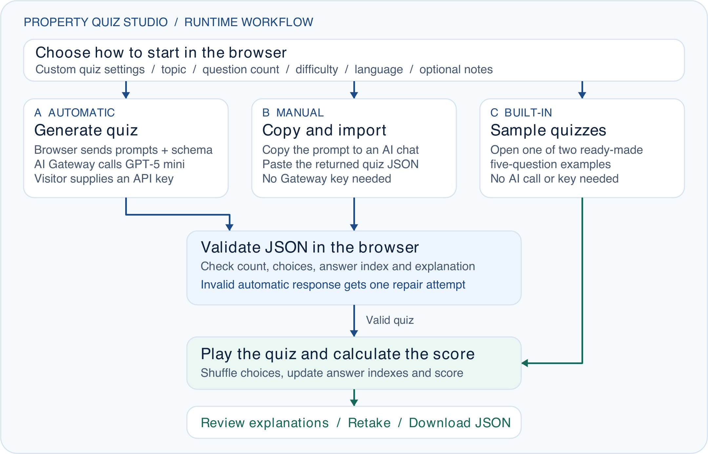

# Property Quiz Studio architecture and workflow

**Assessment option C · Employee Quiz Builder**

Property Quiz Studio turns a trainer’s property topic into a scenario-based knowledge check for 99 Group employees. Learners can take the quiz, review explanations and retake it. Trainers can download the quiz and its answer key as JSON.

[Public demo](https://property-quiz-studio.vercel.app/) · [GitHub repository](https://github.com/ikhlasulamalz/property-quiz-studio)

## Where the app runs

Vercel serves the static HTML, JavaScript and compiled Tailwind CSS from dist/. The browser runs setup, validation, scoring and export. On the automatic path, it sends the quiz inputs directly to Vercel AI Gateway, which routes the request to GPT-5 mini. The application has no custom backend or database. Quiz state lives in the current page, and the app clears the key field when a request starts.

## Quiz workflow

### 1. Set up the quiz

Enter a property topic, choose 5, 8 or 10 questions, select the difficulty and choose English or Bahasa Indonesia. Optional source notes can supply a dated brief. The prompt asks the model to use those notes for time-sensitive or numerical market claims and to use clearly hypothetical scenarios when current evidence is missing.

### 2. Choose a way to load questions

Generate quiz sends a system prompt, the setup values and a JSON schema to AI Gateway with a visitor-supplied key. Use your own AI chat copies the prompt for a separate chat and accepts its JSON response. The two built-in sample quizzes open without an AI request.

### 3. Validate and handle errors

Generated and imported quizzes pass through the same browser parser. It checks the title, exact question count, unique question text, four distinct choices per question, a zero-based answer index from 0 to 3 and a nonempty explanation. Malformed automatic output gets one repair attempt. Import errors ask the user to correct the JSON. Network and HTTP failures are shown immediately.

### 4. Shuffle, score and export

Before display, the browser shuffles choices and remaps each correct answer index. After one answer per question, it compares the selections to the key and shows the score, percentage and explanations. The learner can retake the quiz. The JSON download includes the answer key and can be imported with the matching question count.

## Deployment and verification

The public GitHub repository contains the app, prompts, examples and tests. The project was imported into v0, where a development script was added for the preview. The change was merged through PR #1. Vercel runs npm run build, which compiles the Tailwind stylesheet, and publishes dist/ from the main branch.

The public Vercel demo was verified without login. A test attempt on Jakarta market literacy returned 4/5 and displayed the explanation for the missed question. Five automated tests passed. Successful automatic generation and its retry were tested with simulated provider responses. Running a live generation requires a visitor-supplied key.

[v0 pull request](https://github.com/ikhlasulamalz/property-quiz-studio/pull/1) · [Production deployment](https://vercel.com/ikhlasulamal695-9173s-projects/property-quiz-studio/HoCmCUgse4W42PtQCfxRhdgNGRUF) · [Importable Jakarta quiz](../examples/jakarta-market-literacy.json)

## Next step for internal rollout

For internal rollout, add a trainer review step that checks answer quality and verifies dated market claims against the original brief. The current validator checks response structure.
